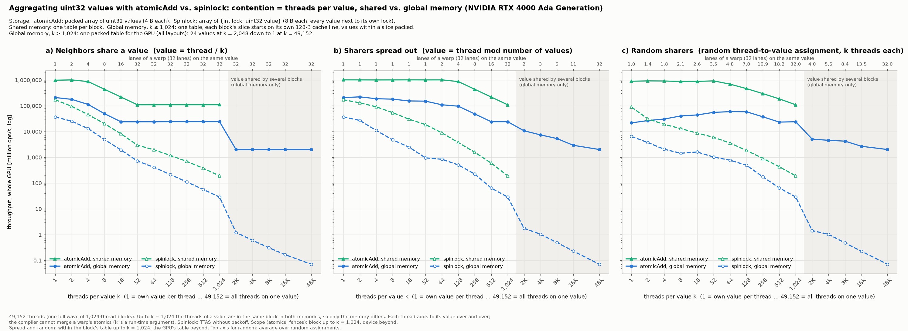

# Threads per value: atomicAdd vs. spinlock, shared vs. global memory

A self-contained GPU microbenchmark: how expensive is aggregating `uint32`
values when k threads share each value, from k = 1 (one value per thread) to
k = all threads (one value)? One source file builds for NVIDIA GPUs (CUDA) and
AMD GPUs (HIP), so both run exactly the same benchmark. A port for Apple GPUs
(Metal, via metal-cpp) runs the same benchmark too; see "Apple (Metal)" below.

```bash
make venv       # once: Python venv with matplotlib for the plot

# NVIDIA (CUDA toolkit; compute capability >= 7.0)
make            # build ./threads_per_value
make test       # exact check of every value in every configuration (~25 s)
make run        # benchmark (~3 min on an RTX 4000 Ada) + plot -> results/

# AMD (ROCm with hipcc)
make hip        # build ./threads_per_value_hip
make test-hip   # exact check, as above
make run-hip    # benchmark + plot -> results_hip/

# Apple silicon (Xcode command line tools with the Metal toolchain, metal-cpp)
make metal      # build ./threads_per_value_metal + threads_per_value.metallib
make test-metal # exact check, as above
make run-metal  # benchmark + plot -> results_metal/
```

The Metal build takes the metal-cpp headers from `~/lingodb-gpu/metal-cpp`;
override with `make metal METAL_CPP=/path/to/metal-cpp`.

The build targets the GPU in the machine; override with `make ARCH=sm_86` or
`make hip HIP_ARCH=gfx90a`.

`make run` / `make run-hip` write to `results/` / `results_hip/`:

- `threads_per_value.csv`: one row per point;
- `threads_per_value.png`: the figure;
- `run.log`: the console log;
- `device.txt`: the GPU name and warp size, used by the plot.

## Reference results

`results/` holds a run on an NVIDIA RTX 4000 Ada Generation (48 SMs,
49,152 threads); `make run` overwrites it.



## What is measured

- The whole GPU runs: one full wave of 1,024-thread blocks, as many per SM/CU
  as the occupancy API allows for every variant (RTX 4000 Ada: 48 SMs × 1 block
  = 49,152 threads; AMD CUs often hold 2 blocks).
- Every thread adds a value in [1, 8] to its one value, over and over. Throughput
  is reported for the whole GPU (million ops/s); every point is verified.
- **Mechanisms:**
  - `atomicAdd` on a packed `uint32` array (4 B per value);
  - a test-and-test-and-set spinlock without backoff on an array of
    `{int lock; uint32 value}` (8 B per value): acquire, add, release. On AMD
    it is written as a try-lock loop, which lock-step GPUs need; see below.
- **Memories:**
  - shared memory: one table per block;
  - global memory, k ≤ 1,024: one table, each block's slice starts on its own
    128-byte cache line;
  - global memory, k > 1,024: one packed table for the GPU (shared memory cannot
    hold a value shared by several blocks).
- **Fairness:** for k ≤ 1,024 the threads of a value are always in the same
  block, in both memories, so only the memory differs.
- **Scope** of atomics and fences: block for k ≤ 1,024, device beyond.
- **Which threads share a value** (one panel each):
  - **neighbors:** consecutive threads (`value = thread / k`);
  - **spread:** as far apart as possible (`value = thread mod number of values`);
  - **random:** a random shuffle of the thread-to-value assignment, still exactly
    k threads per value, each thread always on its value.

  Up to k = 1,024 the mapping works within each block, beyond that across the GPU.
- The plot's top axis shows how many lanes of one warp hit the same value. That
  number, not k itself, drives the cost of atomics. It uses the GPU's warp size
  (32 on NVIDIA and RDNA, 64 on CDNA/Instinct).

## Options

```
./threads_per_value [--out DIR] [--reps R] [--min-ops N] [--max-run-s S] [--test]     (same for threads_per_value_hip)
  --out DIR        output directory (default: results)
  --reps R         timed runs per point, median reported (default: 5)
  --min-ops N      fewest ops per thread in a run (default: 32)
  --max-run-s S    skip points whose single run is projected to take longer
                   (default: 10 on AMD, off on NVIDIA)
  --test           run the exact correctness checks instead of the benchmark
```

Each point calibrates its ops per thread so that one run takes at least 50 ms,
then times R runs within a 3-second budget. The slowest spinlock points (all
threads on a few values) fit only 1–4 runs into that budget.

On GPUs with many more threads (e.g. an MI300X runs ~600K), a single run of the
spinlock points with very few values can take minutes, because every thread does
at least 32 lock rounds on the same few locks. `--min-ops 4` shortens those
points about 8×; fewer than ~4 ops per thread measure mostly the start-up rush
for the lock.

So that such points cannot stall a run, the HIP build skips every point whose
first run is projected to take more than `--max-run-s` seconds (default 10),
printing it as `SKIPPED`. The projection scales the previous k's time per op by
the growth in k (the k threads of a value take turns on its lock); it is rough
and tends to come in somewhat low. Skipped points have no CSV row and are missing
from the plot. Only spinlocks in global memory with many threads per value get
there. The CUDA build skips nothing unless `--max-run-s` is given, and the Metal
build uses the same rule (see below).

## NVIDIA vs. AMD: what differs in the code

The benchmark logic, layouts, sizes, verification and output are identical. The
only platform-specific parts, at the top of `threads_per_value.cu`:

- **Runtime API:** written against CUDA names; with `hipcc` a small block of
  macros maps them to HIP (`cudaMalloc` → `hipMalloc`, …).
- **Scoped atomics:** CUDA `atomicAdd_block` / `atomicAdd` (block / device
  scope) vs. HIP `__hip_atomic_*` builtins with workgroup / agent scope, all
  relaxed. Fences are `__threadfence_block` / `__threadfence` on both.
- **Spinlock loop:**
  - NVIDIA uses the usual loop: spin until the lock is acquired, then run the
    critical section. That is safe thanks to independent thread scheduling
    (sm_70+): the lock holder progresses while its warp-mates spin.
  - AMD wavefronts run their lanes in lock-step. With the usual loop, the lane
    that wins the lock would wait at the end of the spin loop for its
    wave-mates, which wait for that lock: deadlock. So on AMD the lock is a
    try-lock loop: the critical section runs inside the loop, and the winner
    finishes and releases first.
  - Both are the same TTAS lock without backoff, with the same atomics and
    fences. On the RTX 4000 Ada the try-lock loop measured the same as the usual
    loop (every point within ±1.3 %), so the difference should not affect the
    comparison.
- **Warp size** is read from the device (64 on CDNA), and the 128-byte cache line
  used for the per-block slices matches the L2 line of current AMD GPUs too.

The HIP build has been compiled for gfx90a (MI200), gfx942 (MI300) and gfx1100
(RDNA3) with clang 20 and the ROCm 6.4 headers. Every kernel uses native
instructions: `ds_add_u32` / `global_atomic_add` for the atomics,
`ds_wrxchg_rtn_b32` / `global_atomic_swap` for the lock. It has not yet been
run on an AMD GPU: run `make test-hip` first there.

## Apple (Metal)

`threads_per_value.metal` (kernels, MSL 4.1) and `threads_per_value_metal.cpp`
(host, metal-cpp) port the benchmark to Apple GPUs. The op streams, layouts,
mechanisms, scopes, timing, verification, CSV and plot are the same as in
`threads_per_value.cu`; the device code mirrors it one to one. What differs:

- **Scoped atomics:** MSL 4.1 atomics carry their scope in the type,
  `atomic<uint, thread_scope_threadgroup>` / `atomic<uint, thread_scope_device>`,
  all relaxed (`atomic_fetch_add_explicit`, `atomic_exchange_explicit`). Fences
  are `atomic_thread_fence(mem_flags, memory_order_seq_cst, scope)` over the
  memory the table lives in (`mem_threadgroup` or `mem_device`).
- **Spinlock loop:** Apple GPUs run the 32 lanes of a SIMD-group in lock-step,
  as AMD wavefronts do, so the lock is the same try-lock loop as the HIP build.
  The critical section reads and writes the value as a relaxed scoped atomic
  (the CUDA build uses a `volatile` access).
- **Grid size:** Metal has no occupancy query. A probe kernel (1,024-thread
  blocks, 8 KB of threadgroup memory as the largest variant) counts how many
  blocks are resident at once, and the benchmark launches that many: on an
  M3 Ultra, 240 blocks (80 cores × 3) = 245,760 threads. `--blocks B` overrides
  it. The core count comes from the IORegistry and is only printed.
- **Timing:** command buffer `GPUStartTime` / `GPUEndTime` around one dispatch;
  the table is reset by a blit in its own command buffer beforehand (untimed).
- **Skipped points:** spinlocks at device scope (global memory, k > 1,024) are
  very slow on Apple GPUs: a lock hand-off between threads of different cores
  costs 15–120 µs, growing with the number of contenders (the fences are not the
  cause; dropping them makes it slower). One run at k = all threads would take
  over ten minutes. So every point whose first run is projected to take more than
  `--max-run-s` (default 10 s) is skipped and printed as `SKIPPED`; the projection
  scales the previous k's time per op by the growth in k. Skipped points have no
  CSV row and are missing from the plot. Raise `--max-run-s` (or lower
  `--min-ops`) to measure more of them.

```
./threads_per_value_metal [--out DIR] [--reps R] [--min-ops N] [--blocks B] [--max-run-s S] [--test]
  --out DIR        output directory (default: results_metal)
  --blocks B       blocks of 1,024 threads (default: as many as are resident at once)
  --max-run-s S    skip points whose single run is projected to take longer (default: 10)
```
